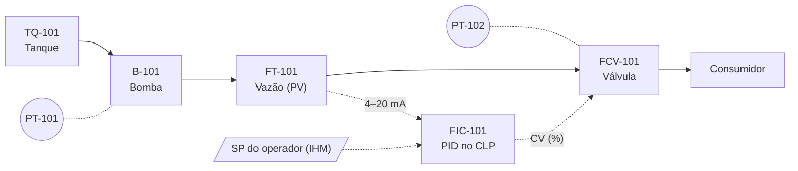

# Simulação de Supervisório para Controle de Vazão (Malha FIC-101)

## 1. Introdução e objetivo

Este trabalho apresenta um sistema supervisório (IHM/SCADA) simulado para uma malha de controle de vazão, identificada como FIC-101. A simulação reproduz uma bomba centrífuga, uma válvula de controle e três transmissores. Um controlador PID, equivalente ao programado em um CLP, mantém a vazão no valor desejado. A simulação roda no navegador e gera relatórios de operação com vazão, pressão, alarmes e desempenho da malha.

O objetivo é mostrar, em funcionamento, os elementos que uma IHM de controle de vazão deve apresentar:

- os parâmetros de processo: PV, SP, CV, vazão totalizada e estado da malha;
- os parâmetros de sintonia do PID;
- os alarmes, as tendências e o horímetro.

A simulação também permite provocar falhas típicas de campo (vazamento, obstrução, cavitação, rompimento de cabo e desarme da bomba). Assim, é possível observar como cada uma aparece nas variáveis e nos alarmes, o que seria arriscado ou caro de fazer em uma planta real.

## 2. Descrição do processo simulado

O processo bombeia água de um tanque de alimentação até um consumidor, passando por uma válvula de controle que regula a vazão. O transmissor de vazão FT-101 envia a medição ao controlador FIC-101. O controlador compara essa medição com o setpoint e ajusta a abertura da válvula FCV-101. Dois transmissores de pressão apoiam o diagnóstico: um na descarga da bomba e outro depois da válvula.



A água segue a linha contínua do tanque ao consumidor. As linhas tracejadas são sinais de instrumentação.

| Tag | Equipamento | Função | Faixa / sinal |
| --- | --- | --- | --- |
| TQ-101 | Tanque de alimentação | Fornece água à sucção da bomba | 0,5 bar na sucção |
| B-101 | Bomba centrífuga | Gera a pressão que movimenta o fluido | Shutoff de 6,0 bar, partida suave de 3 s |
| PT-101 | Transmissor de pressão | Mede a pressão de descarga da bomba | 0–7 bar |
| FT-101 / FE | Transmissor de vazão | Mede a vazão instantânea (PV) | 0–150 L/min em 4–20 mA |
| FIC-101 | Controlador PID (CLP) | Calcula a saída de controle (CV) | Varredura de 100 ms |
| FCV-101 | Válvula de controle | Regula a vazão pela abertura | 0–100 %, igual-percentagem |
| PT-102 | Transmissor de pressão | Mede a pressão a jusante da válvula | 0–7 bar |

## 3. Modelo matemático da planta

A vazão em regime vem do ponto de operação: o encontro da curva da bomba com a curva do sistema (tubulação + válvula). Assim, vazão e pressão são calculadas juntas e se mantêm coerentes. Por exemplo, fechar a válvula reduz a vazão e aumenta a pressão de descarga.

**Curva da bomba.** A pressão fornecida cai com o quadrado da vazão e sobe com o quadrado da rotação *n* (0 a 1):

```math
P_{101} = P_s + H_0\,n^2 - k_b\,Q^2
```

**Válvula igual-percentagem.** O coeficiente de vazão cresce exponencialmente com a abertura *u* (0 a 1), com rangeabilidade *R* = 25:

```math
C_v(u) = C_{v,max}\,R^{\,u-1}
```

**Ponto de operação.** Igualando a pressão disponível às perdas na linha, na obstrução (quando simulada) e na válvula:

```math
Q_{reg} = \sqrt{\dfrac{P_s + H_0\,n^2 - P_c}{k_b + k_l + k_{obs} + 1/C_v(u)^2}}
```

**Dinâmica.** A vazão real segue Q_reg com tempo morto de 0,4 s (transporte do fluido) e um atraso de primeira ordem com constante de tempo de 0,9 s. A válvula também tem dinâmica própria: posicionador com τ = 0,5 s e velocidade máxima de 40 %/s.

```math
G(s) = \dfrac{K\,e^{-0{,}4s}}{0{,}9s + 1}
```

**Transmissor.** O FT-101 converte 0–150 L/min em 4–20 mA (I = 4 + 16·Q/150). Um ruído de turbulência com desvio padrão de cerca de 0,35 L/min é somado ao sinal. Abaixo de 3,8 mA o sinal é considerado inválido, conforme a recomendação NAMUR NE43.

| Parâmetro | Símbolo | Valor |
| --- | --- | --- |
| Pressão de sucção | Ps | 0,5 bar |
| Pressão de shutoff da bomba | H0 | 6,0 bar |
| Contrapressão no destino | Pc | 0,5 bar |
| Coeficiente da curva da bomba | kb | 2,5×10⁻⁴ bar/(L/min)² |
| Perda de carga da linha | kl | 1,2×10⁻⁴ bar/(L/min)² |
| Cv máximo da válvula | Cv,max | 109 (L/min)/√bar |
| Tempo morto / constante de tempo | θ / τ | 0,4 s / 0,9 s |
| Período de varredura do CLP | Ts | 100 ms |

Com esses valores, a vazão máxima com a válvula toda aberta é de cerca de 115 L/min. O ponto nominal de 50 L/min corresponde a cerca de 51 % de abertura.

## 4. Estratégia de controle

O FIC-101 usa um PID na forma padrão ISA, executado a cada 100 ms. A sintonia padrão é Kp = 0,6, Ti = 1,2 s e Td = 0, com saída limitada entre 10 % e 90 %. O erro e a saída são tratados em porcentagem da faixa, como num CLP:

```math
CV(t) = K_p \left[ e(t) + \dfrac{1}{T_i}\int e(t)\,dt - T_d\,\dfrac{d\,PV}{dt} \right], \qquad e = SP - PV
```

O controle de vazão usa basicamente as ações P e I, pelos motivos abaixo.

- **Ação proporcional (Kp):** responde ao erro atual. Sozinha, deixa um erro permanente (offset).
- **Ação integral (Ti):** elimina o erro em regime. É essencial em vazão porque o processo é rápido e não tem integração própria.
- **Ação derivativa (Td):** fica em zero, porque a turbulência gera ruído rápido no sinal e a derivada o amplificaria na válvula. Quando usada, é calculada sobre a PV (não sobre o erro) e filtrada, para que um degrau de SP não dê um tranco na saída.

Além do cálculo básico, o controlador implementa quatro proteções usadas na prática:

1. **Anti-windup por integração condicional:** quando a saída está no limite, a integral para de acumular. Assim, a malha não demora a reagir quando o erro muda de sinal.
2. **Transferência sem solavanco (bumpless):** em manual, a parcela integral acompanha a saída do operador. A volta para automático começa do mesmo valor, sem salto na válvula.
3. **Falha de sinal:** com o FT-101 abaixo de 3,8 mA, a malha vai para manual e a saída fica congelada no último valor. A volta para automático é bloqueada até o sinal voltar. Isso impede o PID de abrir a válvula toda ao "ler" vazão zero.
4. **Bomba parada:** em automático sem bomba, a saída fica no limite mínimo e a integral é reiniciada. Sem isso, a integral se acumularia enquanto não há fluxo.

## 5. Interface homem-máquina

A IHM tem cinco telas, acessadas por abas, e um cabeçalho fixo com o relógio da simulação, a velocidade (×1 a ×60) e o resumo de alarmes. O visual segue a filosofia de IHM de alto desempenho da norma ISA-101. O fundo é cinza neutro e os equipamentos são desenhados em tons de cinza; a cor fica reservada para alarmes e falhas. Assim, o que exige atenção aparece de imediato.

| Tela | O que apresenta | Requisito atendido |
| --- | --- | --- |
| Processo | Sinótico com valores ao vivo; PV em destaque; SP editável; CV e posição real da válvula; modo manual/automático; ligar/desligar bomba; totalizador com reset; horímetro | Parâmetros principais de processo e status da malha |
| Tendências | Curvas de PV, SP e CV sobrepostas e curvas de pressão, com janelas de 1 a 30 min e leitura por cursor | Gráficos de tendência |
| Alarmes | Alarmes ativos com reconhecimento, histórico de alarmes, registro de eventos e tabela de limites | Alarmes de processo e diagnóstico |
| Engenharia (PID) | Kp, Ti, Td, limites de saída e limites de alarme, protegidos por senha | Parâmetros de ajuste e sintonia |
| Relatório | Relatório de operação e exportação em .html e .csv | Registro e documentação do ensaio |

Alguns detalhes da tela de processo seguem a prática industrial:

- **PV:** a vazão aparece em números grandes, com uma barra de 0 a 150 L/min que marca o SP e os quatro limites de alarme.
- **Saída da válvula:** o comando (CV) e a posição real são mostrados separadamente. A diferença entre os dois indica a dinâmica do posicionador.
- **Totalizador:** integra a PV válida no tempo (litros e m³) e pede confirmação antes de zerar. O valor anterior fica registrado no log de eventos.
- **Horímetro:** registra horas de operação e partidas da bomba, além de ciclos e curso acumulado da válvula. Esses dados servem de base para a manutenção preventiva.

Toda ação do operador (mudança de SP, de modo, de sintonia, reset) entra no registro de eventos com o horário.

## 6. Alarmes, falhas simuladas e diagnóstico

O sistema tem oito alarmes e segue o ciclo de vida da norma ISA-18.2. Um alarme fica ativo e não reconhecido, depois ativo e reconhecido, e finalmente normalizado. Se o processo voltar ao normal antes do reconhecimento, o alarme continua pendente na tela até o operador reconhecê-lo. Para evitar alarmes repetitivos (chattering), cada alarme só atua depois de 1 s na condição e só normaliza fora de uma banda morta de 1,5 L/min ou 0,1 bar. Os alarmes de vazão baixa e de pressão baixa ficam inibidos nos primeiros 8 s após a partida da bomba.

| Tag | Condição | Prioridade | Causa provável |
| --- | --- | --- | --- |
| FAHH-101 | Vazão > 105 L/min | Alta | Ruptura ou vazamento de grande porte |
| FAH-101 | Vazão > 85 L/min | Média | Pico de pressão, vazamento |
| FAL-101 | Vazão < 25 L/min | Média | Obstrução, cavitação |
| FALL-101 | Vazão < 10 L/min | Alta | Tubo vazio, linha bloqueada |
| XA-101 | Sinal FT-101 < 3,8 mA | Alta | Rompimento do cabo 4–20 mA |
| PAH-101 | PT-101 > 6,3 bar | Alta | Bomba contra válvula fechada ou linha obstruída |
| PAL-101 | PT-101 < 2,0 bar | Média | Cavitação, baixa sucção |
| YA-101 | Relé térmico atuado | Alta | Sobrecarga do motor da bomba |

O painel do instrutor injeta cinco falhas. Cada uma deixa uma "assinatura" nas variáveis, e é a combinação de sintomas que permite o diagnóstico. Os valores abaixo foram observados no ensaio com SP de 50 L/min e a malha em automático.

| Falha simulada | Vazão (PV) | Saída (CV) | Pressão PT-101 | Alarmes | Leitura do sintoma |
| --- | --- | --- | --- | --- | --- |
| Vazamento entre FT-101 e a válvula | ≈ 100 L/min | 10 % (mínimo) | ≈ 4,0 bar | FAH-101 | O PID fecha a válvula e mesmo assim não reduz a vazão: saída saturada no mínimo indica vazamento |
| Obstrução na linha | ≈ 22 L/min | 90 % (máximo) | ≈ 6,4 bar | FAL-101, PAH-101 | Vazão baixa com pressão alta: a bomba trabalha perto do shutoff contra a restrição |
| Cavitação (baixa sucção) | ≈ 43 L/min, abaixo do SP e ruidosa | 90 % (máximo) | ≈ 1,0 bar | PAL-101 | Válvula toda aberta sem alcançar o SP, com pressão de descarga baixa: falta pressão na sucção |
| Rompimento do cabo 4–20 mA | sem medição | congelada | normal | XA-101 | Sinal próximo de 0 mA; a malha vai para manual e o totalizador para |
| Desarme térmico da bomba | 0 L/min | mínimo | ≈ 0,5 bar (sucção) | YA-101 | Sem rotação não há fluxo; nova partida bloqueada até o rearme |

Na cavitação, o modo da malha muda os sintomas. Em automático (tabela acima), o PID compensa parte da perda abrindo a válvula, e só o alarme de pressão baixa aparece. Em manual, com a válvula parada em cerca de 50 %, a vazão cai para cerca de 20 L/min e o FAL-101 também dispara.

## 7. Ensaio automático e resultados

Com a sintonia padrão, a malha acomodou cada mudança de setpoint em 4 a 12 s, com sobressinal abaixo de 2,5 % e erro em regime praticamente nulo. O ensaio automático cobre 12 minutos de operação e roda em velocidade ×60 (cerca de 13 s reais). No fim, o relatório é gerado sozinho. O roteiro é este:

| Tempo | Ação |
| --- | --- |
| 00:00 | Partida da bomba, malha em automático, SP = 50 L/min |
| 01:00 | Degrau de SP para 80 L/min |
| 02:30 | Degrau de SP para 30 L/min |
| 04:00 | Degrau de SP para 50 L/min |
| 05:00–06:00 | Vazamento de grande porte |
| 07:00–08:00 | Obstrução na linha |
| 09:00–10:00 | Cavitação na bomba |
| 10:30–11:00 | Rompimento do cabo 4–20 mA; volta ao automático em 11:03 |
| 11:30–11:50 | Desarme térmico; nova partida em 11:52 |

Para cada degrau de SP em automático, o relatório calcula quatro índices:

- tempo de subida (10 a 90 % do degrau);
- sobressinal;
- tempo de acomodação (faixa de ±2 % do SP);
- IAE, a integral do erro absoluto, em litros desviados.

| Degrau de SP | Subida 10–90 % | Sobressinal | Acomodação ±2 % | IAE |
| --- | --- | --- | --- | --- |
| 50 → 80 L/min | 2,5 s | 1,4 % | 4,0 s | 0,89 L |
| 80 → 30 L/min | 3,5 s | 0,7 % | 11,5 s | 1,50 L |
| 30 → 50 L/min | 4,5 s | 2,3 % | 6,5 s | 0,81 L |

O degrau para baixo (80 → 30 L/min) acomoda quase três vezes mais devagar que o degrau para cima. A causa é a válvula igual-percentagem. Com pouca abertura, cada 1 % de curso muda pouco a vazão, ou seja, o ganho do processo é menor. Com a mesma sintonia, a malha fica mais lenta nessa região. Isso mostra que uma sintonia fixa é um compromisso entre pontos de operação diferentes.

A tela de engenharia permite repetir o ensaio com outra sintonia e comparar os relatórios:

- **Kp = 2,0:** o sobressinal sobe de 1,4 % para cerca de 8 % e a acomodação dobra (de 4 para 8 s); com Kp = 3 a malha oscila de forma sustentada.
- **Ti = 0:** aparece erro em regime (offset): no degrau para 80 L/min, a vazão para em cerca de 17 L/min.
- **Td = 0,5 s:** o ruído da medição é amplificado e a oscilação da saída da válvula fica cerca de 2,6 vezes maior, sem melhorar a resposta.

## 8. Conclusão e limitações

A simulação atende aos itens propostos para uma IHM de controle de vazão:

- **parâmetros de processo:** PV, SP, CV, vazão totalizada e estado da malha;
- **sintonia protegida:** Kp, Ti, Td e limites de saída, com acesso por senha;
- **alarmes:** HH/H/L/LL e falha de sinal 4–20 mA;
- **diagnóstico:** tendências, horímetro e relatório de operação.

Com a sintonia padrão, a malha segue o setpoint com sobressinal abaixo de 2,5 % e acomodação entre 4 e 12 s. As falhas simuladas mostram que um alarme isolado raramente basta para o diagnóstico. A combinação entre vazão, pressão e saturação da saída do PID é o que distingue vazamento, obstrução e cavitação.

O modelo tem simplificações que devem ser consideradas:

- o fluido é incompressível e a dinâmica é aproximada por tempo morto mais primeira ordem, sem golpe de aríete;
- a cavitação é representada pela queda da altura da bomba e pelo aumento do ruído, sem cálculo de NPSH;
- o vazamento e a válvula descarregam na mesma contrapressão, o que simplifica a divisão de vazão entre os dois caminhos;
- a válvula não tem atrito estático (stiction) nem histerese, que em campo causam oscilações de ciclo-limite.

Essas simplificações não alteram o comportamento qualitativo da malha. Por isso, a ferramenta serve para estudar sintonia, alarmes e diagnóstico, mas não para dimensionar equipamentos reais.
